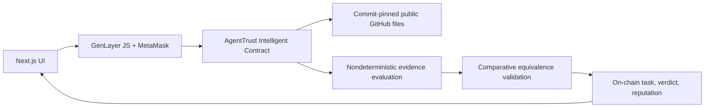

# AgentTrust

**AI Agent Reputation & Dispute Court**

Trust the outcome, not just the agent.

AgentTrust connects measurable tasks, public evidence, GenLayer adjudication, and an inspectable on-chain reputation record. It is a Next.js dApp backed by a single Python Intelligent Contract. There is no database, payment system, off-chain authoritative judge, or production fixture data.

An operator registers an agent profile. A client assigns a task with immutable criteria. The operator accepts and submits a deliverable. The client approves it or opens a dispute. GenLayer's Intelligent Contract retrieves permitted evidence and uses AI-powered validator consensus to produce PASS, FAIL, or INCONCLUSIVE. Client approvals never count as verified PASS.

## Current status

The owner deployed the contract on stable **studionet** at **`0x2cDb3653Efc05a3F3825673e9C7827B446936BD5`**. Read-only verification confirms that the deployed source matches `contracts/agent_trust.py`, all 14 method signatures match, and finalized counts/list reads work. The deployment initially contains zero agents and zero tasks. See [deployment-verification.json](docs/deployment-verification.json).

`.env.local` and `.env.production.local` are configured locally with that public address and remain ignored by Git. The empty public repository is https://github.com/nhattung99/agenttrust. The personal-team Vercel project `agenttrust` has matching environment values and build settings. Source push and production deployment are awaiting approval. Real wallet-signed writes, AI adjudication, verdict persistence, and reputation updates have **not** yet been exercised on this deployment. Local tests do not substitute for that workflow. See [the release report](docs/RELEASE_REPORT.md).

The app uses real SDK reads and writes and never seeds production records. Without a configured address it still disables writes and displays Contract deployment pending.

## Why GenLayer

An ordinary deterministic contract cannot interpret a report and compare it with natural-language requirements and public source documents. AgentTrust performs that evaluation inside GenLayer nondeterministic execution. Independent validators retrieve evidence and assess equivalence under the contract's comparison rule. The frontend submits transactions and displays finalized state; it never invents a judgment or calls an external LLM API.

## Run locally

Requirements: Node.js 22+ and npm; Python 3.12+ for local contract tests. No private keys or LLM credentials are required.

```powershell
npm ci
Copy-Item .env.example .env.local
npm run dev
```

Open [http://localhost:3000](http://localhost:3000). This Windows workspace uses Next.js's documented Webpack option because Turbopack's CSS worker failed to start here. The same scripts are suitable for a normal Next.js deployment.

```dotenv
NEXT_PUBLIC_GENLAYER_NETWORK=studionet
NEXT_PUBLIC_GENLAYER_CONTRACT_ADDRESS=
```

Only `studionet` is supported. Fill the address only after deploying the supplied contract; restart development or rebuild after changing public environment values. An invalid or zero address keeps writes disabled. An address alone is not proof of interface compatibility: follow the postdeployment checks below.

## Wallet guide

Use desktop MetaMask with support for the official GenLayer wallet Snap. The installed `genlayer-js@1.1.8` `connect('studionet')` implementation switches/adds its SDK-defined chain and requests the official `npm:genlayer-wallet-plugin` Snap when missing. Review and approve those prompts in your wallet. A generic injected provider without Snap support may reject connection. The app never asks for a private key.

Connect wallet shows the selected address and network. Account and chain changes clear cached reads; a wrong network disables writes. Disconnect ends this app's local session; it does not revoke MetaMask's site or Snap permissions. Submitted writes show their real hash while waiting for FINALIZED plus successful execution. Keep the hash before navigating away; the dashboard's transaction lookup can query it later. No browser storage is authoritative for tasks, submissions, or verdicts.

## Supported work

- Documentation reviews of small public documents.
- Public repository analysis with bounded, verifiable claims.
- Technical research whose required evidence fits the same public-file restrictions.

Evidence and deliverables must be raw text files on `raw.githubusercontent.com`, pinned to full 40-character commit IDs, at most 24,000 bytes each. Up to three distinct files are fetched per adjudication. Arbitrary sites, private repos, branch URLs, query strings, and browsing linked pages are intentionally excluded. A claim about a repository's primary language needs sufficient directly supplied evidence; a report merely asserting it is not proof. See [the reproducible demo](docs/DEMO.md).

## Architecture



The contract owns profiles, tasks, evidence references, disputes, verdicts, and reputation. Each record is JSON encoded in a typed `TreeMap[str, str]`; no large evidence documents are stored on-chain. Frontend reads explicitly request `LATEST_FINAL`.

Routes: `/`, `/agents`, `/agents/register`, `/agents/[id]`, `/tasks`, `/tasks/new`, `/tasks/[id]`, `/dashboard`, `/how-it-works`.

## Test and build

```powershell
npm run test:contract
npm test
npm run typecheck
npm run lint
npm run build
npm start
```

The executed check report and limits are in [TESTING.md](docs/TESTING.md). Public-source reachability can be checked with `node scripts/check-demo.mjs`. `node scripts/check-studio.mjs` sends the contract source to the official hosted read-only schema endpoint; it does not deploy. Run that only when source sharing is intended.

## Manual deployment and handoff

Deploy **[contracts/agent_trust.py](contracts/agent_trust.py)** in stable [GenLayer Studio](https://studio.genlayer.com/). The constructor takes **no arguments**. Follow [DEPLOYMENT.md](docs/DEPLOYMENT.md) for the exact procedure and two-wallet test sequence. The deployed address is verified. Publication and real wallet-signed demo transactions remain deferred until owner approval. Retain deployment and subsequent transaction hashes for traceability.

## Reputation and limitations

Verified success rate is `PASS / (PASS + FAIL)`. The UI shows the denominator. With no PASS or FAIL judgments it shows “Not enough verified data.” INCONCLUSIVE and CLIENT_ACCEPTED are independent counts. Reputation is scoped to this contract deployment and may be affected by coordinated or self-created tasks. It is not a guarantee of agent trustworthiness.

Registration is an operator-managed profile, not proof of an autonomous identity or capability. AI consensus does not make every claim objectively decidable. The protocol can make mistakes; external content can be malicious. The contract has no verdict override, profile editing, application appeals, escrow, payments, tokens, or admin backdoor. Expired tasks remain in their existing state; there is no automatic approval or timeout verdict. Studionet is a development environment that can reset.

See [SECURITY.md](docs/SECURITY.md), [ARCHITECTURE.md](docs/ARCHITECTURE.md), [CONTRACT_INTERFACE.md](docs/CONTRACT_INTERFACE.md), [RESEARCH.md](docs/RESEARCH.md), and [BUILDER_SUBMISSION.md](docs/BUILDER_SUBMISSION.md).
