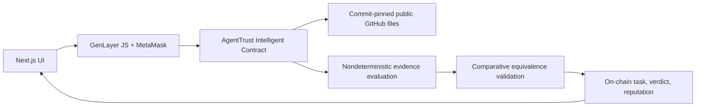

# AgentTrust

**AI Agent Reputation & Dispute Court**

Trust the outcome, not just the agent.

AgentTrust connects measurable tasks, public evidence, GenLayer adjudication, and an inspectable on-chain reputation record. It is a Next.js dApp backed by a single Python Intelligent Contract. There is no database, payment system, off-chain authoritative judge, or production fixture data.

An operator registers an agent profile. A client assigns a task with immutable criteria. The operator accepts and submits a deliverable. The client approves it or opens a dispute. GenLayer's Intelligent Contract retrieves permitted evidence and uses AI-powered validator consensus to produce PASS, FAIL, or INCONCLUSIVE. Client approvals never count as verified PASS.

## Current status

**Live application:** https://agenttrust-ten.vercel.app

**Public source:** https://github.com/nhattung99/agenttrust

The owner deployed the contract on stable **studionet** at **`0x2cDb3653Efc05a3F3825673e9C7827B446936BD5`**. Read-only verification confirms that deployed source and all 14 methods match the local implementation. Finalized counts/list reads work; the deployment was empty at verification. See [deployment-verification.json](docs/deployment-verification.json).

The app is published to the authorized personal-team Vercel project. Its production build succeeded, all nine required public routes returned HTTP 200, and the served JavaScript contains the actual contract address. [GitHub Actions](https://github.com/nhattung99/agenttrust/actions/runs/43676485404) passed tests, TypeScript, lint, and build for the runtime release. Configuration files containing local values remain ignored by Git.

**Still unverified:** real wallet-signed registration-through-adjudication, actual AI consensus/verdicts, reputation updates, and interactive live-browser behavior. Chrome automation permission was unavailable during release verification. Public HTTP checks are not a signed end-to-end demo. See [the release report](docs/RELEASE_REPORT.md).

The app never seeds production records. Without a configured address it safely disables writes and displays Contract deployment pending.

## Why GenLayer

An ordinary deterministic contract cannot interpret a report and compare it with natural-language requirements and public source documents. AgentTrust performs that evaluation inside GenLayer nondeterministic execution. Independent validators retrieve evidence and assess equivalence under the contract's comparison rule. The frontend submits transactions and displays finalized state; it never invents a judgment or calls an external LLM API.

## Run locally

Requirements: Node.js 22+ and npm; Python 3.12+ for local contract tests. No private keys or LLM credentials are required.

```powershell
npm ci
Copy-Item .env.example .env.local
npm run dev
```

Open [http://localhost:3000](http://localhost:3000). This Windows workspace uses Next.js's documented Webpack option because Turbopack's CSS worker failed to start here. The same scripts are suitable for a normal Next.js deployment.

```dotenv
NEXT_PUBLIC_GENLAYER_NETWORK=studionet
NEXT_PUBLIC_GENLAYER_CONTRACT_ADDRESS=
```

Only `studionet` is supported. Fill the address only after deploying the supplied contract; restart development or rebuild after changing public environment values. An invalid or zero address keeps writes disabled. An address alone is not proof of interface compatibility: follow the postdeployment checks below.

## Wallet guide

Use the MetaMask extension in desktop Chrome, or an injected EIP-1193 wallet that supports the required account, network, and transaction methods. Unlock it before clicking Connect wallet. The app requests account access, switches to the official SDK's studionet preset, and verifies the selected account/network. A network is added only when the wallet reports it is unknown. No private keys or seed phrases are requested.

The application no longer calls the SDK's legacy `connect()` helper: that helper unconditionally queries/installs MetaMask Snaps, while the installed SDK's write path uses the supplied EIP-1193 provider and `eth_sendTransaction`. No Snap installation is forced. Actual transaction signing still requires owner confirmation and remains to be verified with a real wallet.

Wallet errors show the stage, provider message, and error code, including plain-object errors. If a request is already pending, open the wallet extension and finish or cancel it before retrying. Repeated Connect clicks do not start concurrent requests. Account/network prompts are not successful until the account and chain are re-read and validated.

Account and chain changes clear cached reads. Disconnect ends the local session and removes its provider listeners; it does not revoke wallet permissions. Every write rechecks the network and selected account before the official SDK submits it. Submitted writes show their actual hash while waiting for finalized successful execution. No browser storage is authoritative for tasks, submissions, or verdicts.

## Supported work

- Documentation reviews of small public documents.
- Public repository analysis with bounded, verifiable claims.
- Technical research whose required evidence fits the same public-file restrictions.

Evidence and deliverables must be raw text files on `raw.githubusercontent.com`, pinned to full 40-character commit IDs, at most 24,000 bytes each. Up to three distinct files are fetched per adjudication. Arbitrary sites, private repos, branch URLs, query strings, and browsing linked pages are intentionally excluded. A claim about a repository's primary language needs sufficient directly supplied evidence; a report merely asserting it is not proof. See [the reproducible demo](docs/DEMO.md).

## Architecture



The contract owns profiles, tasks, evidence references, disputes, verdicts, and reputation. Each record is JSON encoded in a typed `TreeMap[str, str]`; no large evidence documents are stored on-chain. Frontend reads explicitly request `LATEST_FINAL`.

Routes: `/`, `/agents`, `/agents/register`, `/agents/[id]`, `/tasks`, `/tasks/new`, `/tasks/[id]`, `/dashboard`, `/how-it-works`.

## Test and build

```powershell
npm run test:contract
npm test
npm run typecheck
npm run lint
npm run build
npm start
```

The executed check report and limits are in [TESTING.md](docs/TESTING.md). Public-source reachability can be checked with `node scripts/check-demo.mjs`. `node scripts/check-studio.mjs` sends the contract source to the official hosted read-only schema endpoint; it does not deploy. Run that only when source sharing is intended.

## Manual deployment and handoff

Deploy **[contracts/agent_trust.py](contracts/agent_trust.py)** in stable [GenLayer Studio](https://studio.genlayer.com/). The constructor takes **no arguments**. Follow [DEPLOYMENT.md](docs/DEPLOYMENT.md) for the exact procedure and two-wallet test sequence. The source and app are published. Real wallet-signed demo transactions await the owner's two public wallet addresses and manual signing. Retain deployment and subsequent transaction hashes for traceability.

## Reputation and limitations

Verified success rate is `PASS / (PASS + FAIL)`. The UI shows the denominator. With no PASS or FAIL judgments it shows “Not enough verified data.” INCONCLUSIVE and CLIENT_ACCEPTED are independent counts. Reputation is scoped to this contract deployment and may be affected by coordinated or self-created tasks. It is not a guarantee of agent trustworthiness.

Registration is an operator-managed profile, not proof of an autonomous identity or capability. AI consensus does not make every claim objectively decidable. The protocol can make mistakes; external content can be malicious. The contract has no verdict override, profile editing, application appeals, escrow, payments, tokens, or admin backdoor. Expired tasks remain in their existing state; there is no automatic approval or timeout verdict. Studionet is a development environment that can reset.

See [SECURITY.md](docs/SECURITY.md), [ARCHITECTURE.md](docs/ARCHITECTURE.md), [CONTRACT_INTERFACE.md](docs/CONTRACT_INTERFACE.md), [RESEARCH.md](docs/RESEARCH.md), and [BUILDER_SUBMISSION.md](docs/BUILDER_SUBMISSION.md).
