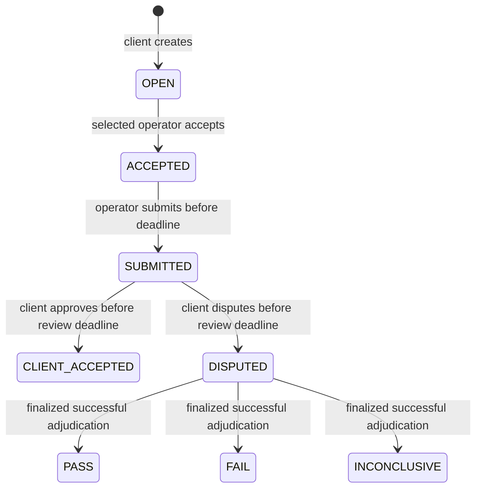

# Architecture

## Ownership and state

One `AgentTrust(gl.Contract)` class stores profiles and tasks in `TreeMap[str, str]`. JSON snapshots contain only bounded text and references. Incrementing counters assign decimal string IDs starting at `1`. An operator/name pair is unique after trimming and lowercasing the name; different operators can register the same display name, so inspect the operator address. Agent metadata is immutable in v1.

Tasks freeze their client, agent, operator, description, ordered criteria, evidence policy, and deadlines at creation. The single submission and dispute are also immutable. There is no update, deletion, admin, migration, or override method. Reputation counters are stored on the agent and updated atomically with a terminal task transition.

`ADJUDICATING` is not stored: the UI shows a submitted transaction while the finalized task remains DISPUTED. A transaction that aborts, times out, or has no consensus does not create a verdict. There is no application appeal. Protocol-level behavior and finality are owned by GenLayer.

## Adjudication

`adjudicate_dispute` accepts only a DISPUTED task. Its trigger is permissionless. Within a function passed to `gl.eq_principle.prompt_comparative`, it fetches the operator's evidence, deliverable, and client evidence with `gl.nondet.web.get`, deduplicating exact URLs. It accepts status 200, UTF-8, non-NUL bodies up to 24,000 bytes each. A failure of any required retrieval yields an explicit INCONCLUSIVE candidate for validator evaluation.

When retrieval completes, `gl.nondet.exec_prompt(..., response_format='json')` assesses every immutable criterion. External text and all user text are delimited as untrusted data. The schema requires exactly ordered C1…Cn identifiers, each with MET, UNMET, or UNKNOWN and bounded reasoning. Invalid model output raises an execution error. There is no hardcoded substantive PASS/FAIL.

Each validator independently executes the retrieval and assessment. Comparative equivalence requires exactly matching outcome and criterion classifications and agreement on material facts; natural-language explanations need not match character for character. This is not strict string equality. The network selects its actual validators/providers. `leaderOnly: false` requests normal validation; the application does not invent committee size, model assignments, or RPC settings.

After equivalence succeeds, deterministic normalization derives INCONCLUSIVE if any criterion is UNKNOWN, FAIL if an UNMET remains with no UNKNOWN, and PASS only if all are MET. The task, evidence references, timestamp, and one reputation counter are committed atomically. This conservative UNKNOWN precedence is deliberate.

## Frontend

Next.js App Router, strict TypeScript, Tailwind v4, a shadcn-style Radix/CVA Button component, Lucide, Zod, and TanStack Query. The integration imports the official `studionet` preset. Reads require no wallet and request `TransactionHashVariant.LATEST_FINAL`. Writes use the selected address and injected provider through the official SDK.

Transaction UI distinguishes signing, submitted, finalized successful execution, failure, and unknown confirmation. Once a hash exists, an RPC/polling error is not permission to duplicate the write. The current panel offers rechecking that hash. Dashboard lookup supports manual recovery after navigation. Hashes are not persisted by the contract or the browser; users should retain them. On-chain records do not rely on local storage.

Directory and history queries are paginated (up to 50 contract records per read). Searches and status filters apply to the current page only. Dashboard task filtering uses each task's frozen client/operator fields. Agent history filters a page of global task history; its label makes this limitation explicit. There is no database or full-text index.
